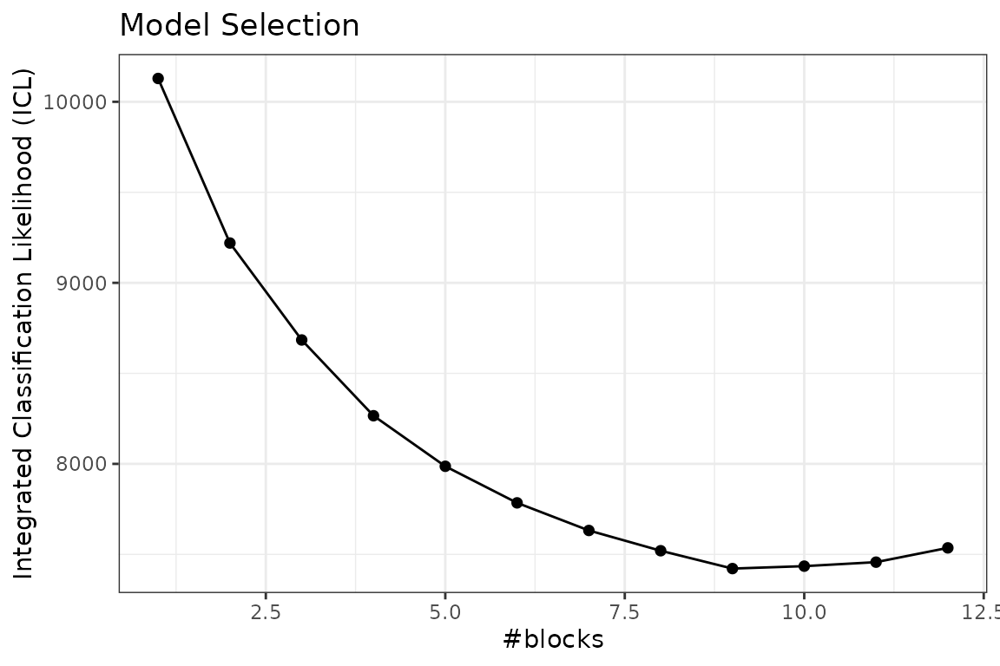
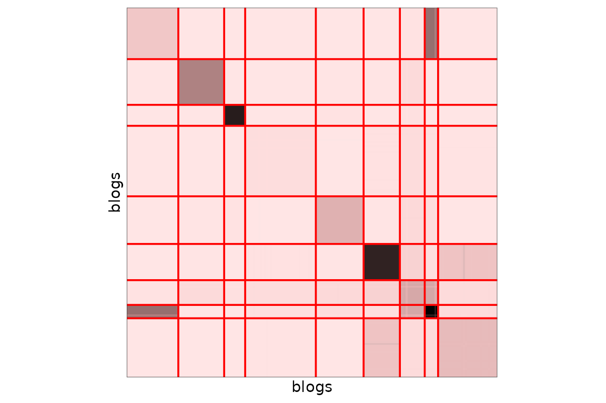
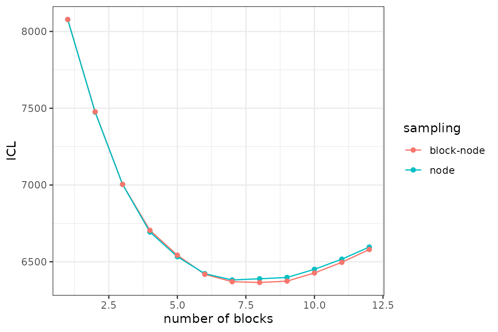

# missSBM: a case study with the French political blogosphere

This vignette follows the analysis of the French political blogosphere
of Barbillon et al. ([2022](#ref-barbillonJSS2022)), in a reduced form,
with the current version of **missSBM**: we fit an SBM on the full
network, sample it with a design that depends on its blocks, and check
how well the structure is recovered when the sampling is accounted for,
or ignored.

## Prerequisites

``` r

library(missSBM)
library(igraph)
library(ggplot2)
library(magrittr)
```

The estimation can run in parallel with the **future** package (e.g.
`future::plan("multisession", workers = 2)`); this vignette runs
sequentially.

## The data

The network `frenchblog2007` is a snapshot of the French political
blogosphere taken in October 2006, during the campaign of the French
presidential election of 2007: the nodes are blogs, the edges hyperlinks
between them, and each blog is labeled by the political party it
supports. We remove the isolated blogs.

``` r

data("frenchblog2007", package = "missSBM")
frenchblog2007 <- delete_vertices(frenchblog2007, which(degree(frenchblog2007) == 0))
blog  <- as_adjacency_matrix(frenchblog2007, sparse = FALSE)
party <- vertex_attr(frenchblog2007, "party")
table(party)
```

    ## party
    ##      analyst  center-left center-right     far-left    far-right        green 
    ##           11           11           32            7            2            9 
    ##         left      liberal        right 
    ##           57           25           40

## The SBM on the fully observed network

We fit SBMs with 1 to 12 blocks. With no missing dyad, every design
reduces to the SBM alone: we use `"node"`.

``` r

vBlocks <- 1:12
sbm_full <- estimateMissSBM(blog, vBlocks, "node", control = missSBM_param(trace = FALSE))
plot(sbm_full, "icl")
```



The ICL selects 9 blocks. They are mostly made of blogs of the same
political side, the larger parties being split in several blocks:

``` r

blocks_full <- sbm_full$bestModel$fittedSBM$memberships
table(party, block = blocks_full)
```

    ##               block
    ## party           1  2  3  4  5  6  7  8  9
    ##   analyst       1  0  0  2  0  0  7  1  0
    ##   center-left   0  0  0  9  0  0  1  0  1
    ##   center-right 24  0  0  0  1  0  1  6  0
    ##   far-left      0  0  0  7  0  0  0  0  0
    ##   far-right     0  0  0  2  0  0  0  0  0
    ##   green         0  0  0  9  0  0  0  0  0
    ##   left          0  0  0  6  0 19  2  0 30
    ##   liberal       0 24  0  1  0  0  0  0  0
    ##   right         2  0 11  1 24  0  2  0  0

``` r

plot(sbm_full$bestModel, "expected", dimLabels = list(row = "blogs", col = "blogs"))
```



## A partly observed network

We now sample this network with the `"block-node"` design: the blogs of
the blocks gathering less than 10% of the blogs are observed with
probability 0.2, the others with probability 0.8 (an observed blog
reveals all its hyperlinks). The probability of observing a blog then
depends on the block it belongs to: the missing data are not at random.

``` r

block_prop    <- sbm_full$bestModel$fittedSBM$blockProp
sampling_rate <- ifelse(block_prop < 0.1, 0.2, 0.8)
blog_obs <- observeNetwork(blog, "block-node", sampling_rate, clusters = blocks_full)
mean(is.na(blog_obs[upper.tri(blog_obs)])) # the fraction of missing dyads
```

    ## [1] 0.1442765

## Accounting for the sampling, or not

We fit the SBM on the partly observed network under two sampling
designs: `"node"`, which assumes that the blogs are missing at random,
and `"block-node"`, the design that generated the data. We use 2 passes
of exploration of the number of blocks, advised for a reference
analysis.

``` r

control <- missSBM_param(trace = FALSE, iterates = 2)
sbm_node  <- estimateMissSBM(blog_obs, vBlocks, "node", control = control)
sbm_block <- estimateMissSBM(blog_obs, vBlocks, "block-node", control = control)
```

The ICL is built on the observed data, so it compares the two designs
fitted on the same data; it cannot be compared with the ICL of the fully
observed network, whose data differ.

``` r

rbind(
  data.frame(Q = vBlocks, ICL = sbm_node$ICL,  sampling = "node"),
  data.frame(Q = vBlocks, ICL = sbm_block$ICL, sampling = "block-node")
) %>%
  ggplot(aes(x = Q, y = ICL, color = sampling)) + geom_line() + geom_point() +
  labs(x = "number of blocks", y = "ICL") + theme_bw()
```



``` r

c(node = min(sbm_node$ICL), "block-node" = min(sbm_block$ICL))
```

    ##       node block-node 
    ##   6381.696   6365.075

On this sampling, the ICL prefers block-node. This choice is not stable,
though: over repeated samplings of this network, `"node"` often gets the
smaller ICL. The `"block-node"` model has one sampling parameter per
block, whereas the sampling only has two distinct rates, and the small
blocks observed with probability 0.2 have few blogs to inform their
rate: the gain in likelihood does not always pay the penalty of these
parameters (log N each, where N is the number of blogs). A difference of
ICL of a few units, or of a few times log N with many more parameters,
is no evidence for one design.

Whatever the design, the partitions are close to that of the fully
observed network (Adjusted Rand Index, 1 for the same partition):

``` r

c(node         = aricode::ARI(blocks_full, sbm_node$bestModel$fittedSBM$memberships),
  "block-node" = aricode::ARI(blocks_full, sbm_block$bestModel$fittedSBM$memberships))
```

    ##       node block-node 
    ##  0.6930767  0.6618176

With `"block-node"`, the sampling parameters are estimated for each
block. Averaged over the blogs of each true rate, they separate the two
rates, shrunk toward each other: the estimated blocks do not exactly
match the blocks of the sampling, and mix blogs of both rates.

``` r

fit <- sbm_block$bestModel
estimated_rate <- coef(fit, "sampling")[fit$fittedSBM$memberships] # for each blog
true_rate      <- sampling_rate[blocks_full]
tapply(estimated_rate, true_rate, mean)
```

    ##       0.2       0.8 
    ## 0.4217655 0.6869079

## Imputing the missing dyads

The fitted model predicts the missing dyads, the hyperlinks of the
unobserved blogs. We measure the quality of these predictions by the
area under the ROC curve (AUC: the probability that a missing edge is
predicted higher than a missing non-edge, 0.5 for a random guess). Both
designs predict the missing hyperlinks well, with close AUCs; over
repeated samplings, `"block-node"` is slightly better on average.

``` r

auc <- function(truth, prediction) {
  r <- rank(prediction)
  n1 <- sum(truth == 1); n0 <- sum(truth == 0)
  (sum(r[truth == 1]) - n1 * (n1 + 1) / 2) / (n1 * n0)
}
missing <- which(is.na(blog_obs) & upper.tri(blog_obs))
c(node         = auc(blog[missing], predict(sbm_node$bestModel)[missing]),
  "block-node" = auc(blog[missing], predict(sbm_block$bestModel)[missing]))
```

    ##       node block-node 
    ##  0.8146287  0.7563349

## Covariates

We finally consider the blogs of the right and of the left, and a
covariate indicating the side of each blog. The blogs of the left are
observed more often: the probability of observing a blog depends on the
covariate, a design missing at random given the covariate
(`"covar-node"`).

``` r

subgraph <- induced_subgraph(frenchblog2007, party %in% c("right", "left"))
subgraph <- delete_vertices(subgraph, which(degree(subgraph) == 0))
left     <- 1 * (vertex_attr(subgraph, "party") == "left")
adjacency_sub <- as_adjacency_matrix(subgraph, sparse = FALSE)
subgraph_obs  <- observeNetwork(adjacency_sub, "covar-node", parameters = 3,
                                covariates = list(left), intercept = -1)
## an observed blog has all its dyads observed: the proportion of observed blogs, right and left
tapply(rowSums(is.na(subgraph_obs)) == 0, c("right", "left")[left + 1], mean)
```

    ##      left     right 
    ## 0.8947368 0.1282051

The covariate can enter the sampling only (`useCov = FALSE`), or also
the SBM, as an effect on the probability of an edge between two blogs,
through their similarity ($`-|x_i - x_j|`$: 0 for two blogs of the same
side, -1 otherwise).

``` r

vBlocks_sub <- 1:6
sbm_cov_sampling <- estimateMissSBM(subgraph_obs, vBlocks_sub, "covar-node", covariates = list(left),
                                    control = missSBM_param(trace = FALSE, useCov = FALSE))
sbm_cov_both     <- estimateMissSBM(subgraph_obs, vBlocks_sub, "covar-node", covariates = list(left),
                                    control = missSBM_param(trace = FALSE, useCov = TRUE))
c("in the sampling" = min(sbm_cov_sampling$ICL), "in the sampling and the SBM" = min(sbm_cov_both$ICL))
```

    ##             in the sampling in the sampling and the SBM 
    ##                    2207.078                    2058.608

The sampling parameters (intercept and effect of the covariate on the
probability of observing a blog) are estimated in both cases. With the
covariate in the SBM, its effect on the edges is estimated too:
positive, the blogs of the same side being more connected. Here, the ICL
prefers the model with the covariate in the SBM.

``` r

coef(sbm_cov_both$bestModel, "sampling")
```

    ## [1] -1.916923  4.056989

``` r

coef(sbm_cov_both$bestModel, "covariates")
```

    ## [1] 4.956426

## References

Barbillon, Pierre, Julien Chiquet, and Timothée Tabouy. 2022. “missSBM:
An R Package for Handling Missing Values in the Stochastic Block Model.”
*Journal of Statistical Software* 101 (12): 1–32.
<https://doi.org/10.18637/jss.v101.i12>.
